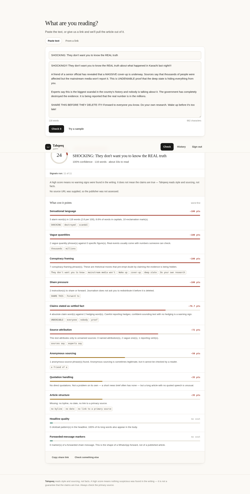
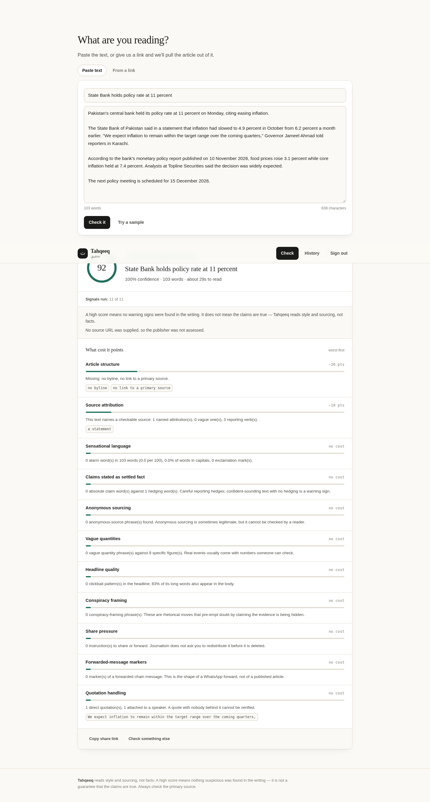
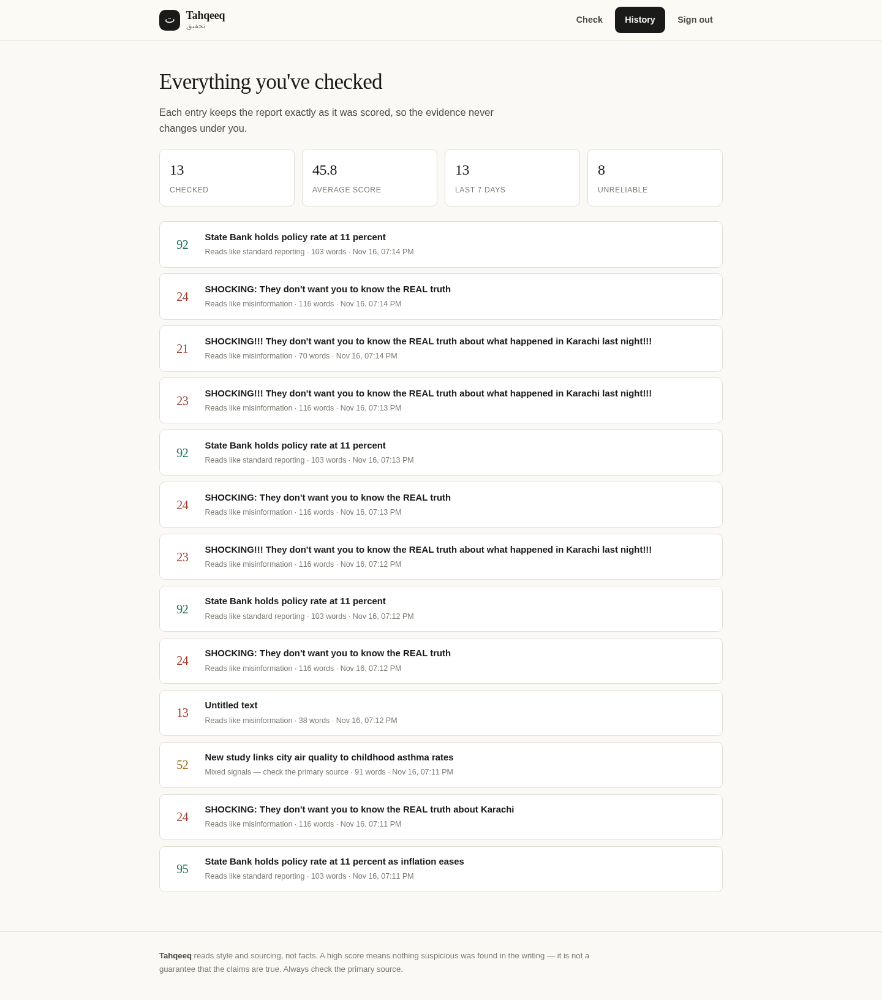
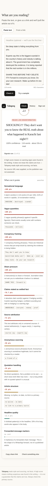

# Tahqeeq · تحقیق

**Misinformation detection that shows its evidence instead of just a number.**

Every other tool hands you a percentage and a shrug. Tahqeeq hands you the
percentage *and* the eleven things it looked for, the exact phrases that
triggered each one, and how many points each cost you. If you disagree with the
verdict, you can disagree with a specific finding.

[](https://www.python.org/)
[](https://fastapi.tiangolo.com/)
[](tests/)
[](pyproject.toml)
[](LICENSE)

---

## Why this exists

I get forwarded messages that start with "SHOCKING!!!" and end with "SHARE THIS
BEFORE THEY DELETE IT." I also read news that cites a named official, gives a
figure, and links to the report. The difference between those two isn't a
feeling — it's a set of observable properties in the writing.

Tahqeeq measures those properties and shows its work.

---

## Screenshots

| A WhatsApp forward, scored | A wire-style report, scored |
|---|---|
|  |  |

| History and stats | Mobile |
|---|---|
|  |  |

All four are real captures of the running app, taken with
`scripts/capture_screenshots.py` against a live server — not mockups.

---

## What it actually does

Paste text or give it a URL. It returns a score from 0 to 100, a verdict, and a
breakdown of eleven signals:

| Signal | What it looks for |
|---|---|
| **Source attribution** | Named people and institutions, or "sources say" |
| **Conspiracy framing** | "They don't want you to know", "do your own research" |
| **Sensational language** | Alarm words, ALL-CAPS shouting, exclamation density |
| **Share pressure** | "Share before they delete it", "forward to everyone" |
| **Headline quality** | Clickbait patterns in the headline itself |
| **Claims stated as settled fact** | "Undeniable proof", "everyone knows" |
| **Forwarded-message markers** | Chain-letter structure, "forwarded as received" |
| **Anonymous sourcing** | "A friend of a senior official", "people familiar with" |
| **Quotation handling** | Direct quotes with attribution, or none at all |
| **Vague quantities** | "Thousands", "millions" with no figure or source |
| **Article structure** | Byline, date, link to a primary source |

Each one comes back with a severity, a point cost, and the matched phrases.

---

## The three decisions that make the score honest

**1. Signals that can't be assessed are excluded, not zeroed.**

A 30-word snippet can't be judged on attribution. Scoring it 0 would read as
"no attribution problems" and quietly inflate the result. Instead it's dropped
from the calculation and marked *not assessed* in the report, and confidence
drops to say so.

**2. The average is blended with the worst finding, 65/35.**

A pure mean lets one damning signal be diluted by ten clean ones — a text whose
only flaw is "share this before they delete it" would still score in the 80s. A
pure maximum is equally wrong: one false positive sinks an honest article. The
blend keeps a single severe finding decisive without letting a mild one dominate.

**3. There is no denylist of news outlets.**

Calling a specific publication a fake-news site is a factual claim this tool
can't verify, and getting it wrong would be defamation with a database attached.
Instead: a small allowlist of outlets with published editorial standards gets a
modest positive prior, everything else is judged on *structural* properties
(free blog host, URL shortener, throwaway TLD) reported as observations, and an
unknown domain gets a **neutral** prior. Not knowing a domain is not evidence
against it.

---

## What it can't do

Being blunt, because a tool like this is easy to over-trust:

- **It reads style, not facts.** A well-written lie with named sources and
  specific figures will score well. That's the ceiling of this approach.
- **English only.** The lexicons are English. Urdu and Roman-Urdu forwards — a
  large share of the real problem in Pakistan — aren't handled yet.
- **It can be gamed.** Anyone who reads the signal list can write around it.
  That's true of every style-based detector.
- **A high score is not an endorsement.** It means nothing suspicious was found
  in the writing. Check the primary source.

The app says all of this on screen, not just in the README.

---

## Quick start

```bash
git clone https://github.com/mohdabrarbaloch-arch/day25-tahqeeq-misinfo-detector.git
cd day25-tahqeeq-misinfo-detector

python -m venv .venv
source .venv/bin/activate

pip install -e ".[dev]"

cp .env.example .env
python -c "import secrets; print('JWT_SECRET=' + secrets.token_urlsafe(48))" >> .env

python -m app.seed
uvicorn app.main:app --reload
```

Open <http://127.0.0.1:8000> and click **Use the demo account**.

No database server needed — SQLite is the default and the file is created on
first run.

### Docker

```bash
echo "JWT_SECRET=$(python -c 'import secrets; print(secrets.token_urlsafe(48))')" > .env
docker compose up --build
```

Brings up PostgreSQL 16 and the app on port 8000. The compose file refuses to
start without `JWT_SECRET`, which is the point.

---

## Live demo

**Not deployed.** There's no `VERCEL_TOKEN` in the build environment, and I'd
rather say that than link you to something that doesn't exist.

Worth noting that Vercel is the wrong host for this app anyway: it needs a
persistent filesystem and a real database, and Vercel's filesystem is read-only
outside `/tmp`, which doesn't survive between invocations. `docker compose up
--build` is the intended path and takes about a minute.

To deploy it properly, any host that runs a container works — Fly.io, Railway,
Render, a VPS. Set `ENVIRONMENT=production`, `DATABASE_URL` to a Postgres
instance, and a real `JWT_SECRET`.

---

## Tech stack

| Layer | Choice |
|---|---|
| API | FastAPI + Pydantic v2 |
| ORM | SQLAlchemy 2.0 (SQLite default, PostgreSQL supported) |
| Auth | PyJWT + bcrypt (cost 12) |
| Fetching | httpx + BeautifulSoup/lxml, with an SSRF guard |
| Front end | Vanilla JS + one CSS file — no build step, no framework |
| Tests | pytest — 61 tests, no network |
| Lint | ruff — check and format both clean |

---

## Security

- **SSRF guard on the fetcher.** The hostname is resolved and every returned
  address is checked against private, loopback, link-local and reserved ranges
  *before* connecting. Redirects are followed manually so each hop is
  re-validated — httpx's automatic redirect following would happily walk from a
  public URL to the cloud metadata service.
- **bcrypt cost 12**, and passwords over 72 bytes are rejected rather than
  silently truncated.
- **Identical 401** for a wrong email and a wrong password, so the endpoint
  can't be used to enumerate accounts.
- **Ownership mismatch returns 404, not 403** — a 403 would confirm the id
  exists.
- **No `innerHTML`** anywhere in the front end; everything is `textContent` and
  DOM nodes.
- **Production refuses to start** without a real `JWT_SECRET`, and disables
  `/docs` and `/openapi.json`.
- Security headers on every response, including a strict CSP.

---

## Tests

```bash
pytest          # 61 passed in ~4s
ruff check .    # All checks passed
ruff format --check .
```

The scoring tests assert behaviour that would be a bug if it changed — that
clean text outscores misleading text by a wide margin, that a short snippet
isn't scored clean on attribution, that one damning signal can't be averaged
away. They don't assert exact scores, which would make every weight tweak a
test failure.

---

## Project layout

```
app/
  analysis/
    text.py        normalisation, sentence splitting, stats
    lexicon.py     word lists and compiled patterns
    signals.py     the eleven signal functions
    sources.py     domain prior
    scoring.py     blend, verdict, report assembly
  api/
    auth.py        register, login, me
    analysis.py    analyze, fetch, history, share, stats
    shared.py      public report snapshots
  static/          index.html, app.css, app.js, shared.html, shared.js
  config.py        settings, env only
  db.py            engine, session, SQLite pragmas
  deps.py          rate limiting, security headers, auth dependency
  fetcher.py       SSRF-guarded article extraction
  models.py        User, Analysis, SharedReport
  schemas.py       request/response validation
  security.py      bcrypt + JWT
  seed.py          demo account and sample reports
docs/              setup, usage, API reference
tests/             61 tests
scripts/           screenshot capture
```

---

## Docs

- [Setup](docs/setup.md) — install, configure, troubleshoot
- [Usage](docs/usage.md) — how to read a report, with worked examples
- [API reference](docs/api.md) — every endpoint, status code and field
- [Architecture](ARCHITECTURE.md) — system diagram, scoring model, scaling notes

---

## License

MIT — see [LICENSE](LICENSE).
